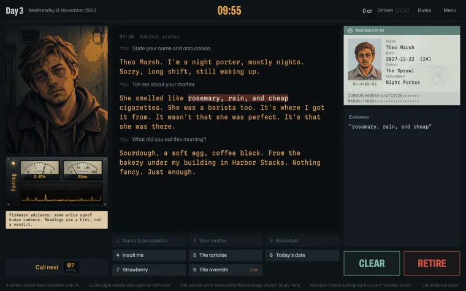
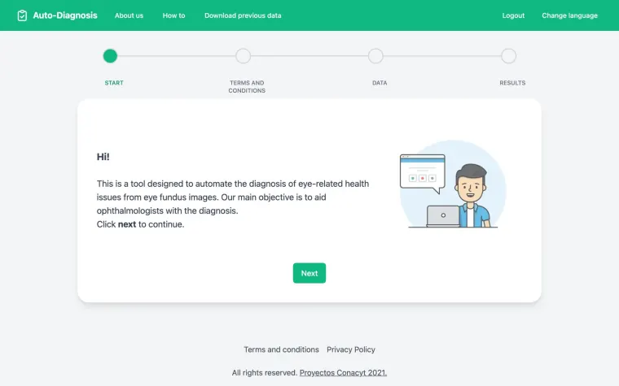

<a href="https://jordanbuilds.io">
  <picture>
    <source media="(prefers-color-scheme: dark)" srcset="./assets/banner-dark.svg">
    <source media="(prefers-color-scheme: light)" srcset="./assets/banner-light.svg">
    
  </picture>
</a>

  
  
  
  

I'm a forward deployed AI engineer with 12+ years in software. I build agentic systems, from real-time voice agents to the tool-calling backends behind them, and ship them to production alongside the teams that run them. Before that I led engineering teams, shipped mobile apps, and built ML systems for healthcare and logistics.

**Right now**

- **At [Saywise](https://saywise.com)**, building conversational AI agents: real-time streaming pipelines, voice (OpenAI, ElevenLabs, Deepgram), and infrastructure that keeps responses under a second.
- **On the side**, running [Tokiyo](https://tokiyo.jordanbuilds.io), a free timer for figure-drawing practice, and [RUNBLADE](https://runblade.jordanbuilds.io), a noir game about telling people from machines.
- **Ask me about** agentic systems, voice agents, evals, or getting an AI prototype into production.

**Things I've built**

<table>
  <tr>
    <td width="50%" valign="top">
      <a href="https://tokiyo.jordanbuilds.io">
        <picture>
          <source media="(prefers-color-scheme: dark)" srcset="./assets/tokiyo-dark.webp">
          
        </picture>
      </a>
      
<a href="https://tokiyo.jordanbuilds.io"><b>Tokiyo</b></a>

      
Timed photo references for figure drawing. Pick a set of poses, or bring your own from Are.na or Cosmos, and draw while Tokiyo keeps time. Free, no account.

      
<b>Figure drawing · Gesture practice · Timed poses · Curated pose sets</b>

    </td>
    <td width="50%" valign="top">
      
      
<a href="https://runblade.jordanbuilds.io"><b>RUNBLADE</b></a>

      
How well do you know AI? A noir interrogation game: question the subjects, spot the tells, and retire the machines before they replace us.

      
<b>Noir · Sci-fi · Interrogation · Deduction · Pixel art</b>

    </td>
  </tr>
  <tr>
    <td width="50%" valign="top">
      
      
<a href="https://github.com/jordanbuildsio/seer"><b>Seer</b></a>

      
Machine learning that tells a trading rule when not to sell. A price forecast vetoes the false sell signals of TEMA and MACD; in 2019 backtests on the IBEX, DAX and Dow Jones, the hybrid rules earned more on every index with far fewer trades. First-author paper in <i>Knowledge-Based Systems</i> (Elsevier, 2021).

      
<b>R · quantstrat · caret</b> · <a href="https://doi.org/10.1016/j.knosys.2021.107119">Paper</a> · <a href="https://github.com/jordanbuildsio/OHLCMerge">OHLCMerge</a>

    </td>
    <td width="50%" valign="top">
      
      
<a href="https://github.com/uamericana/PINV18_846-Experiments"><b>Auto Retinopathy</b></a>

      
Grading diabetic retinopathy from an eye fundus photo, for a CONACYT-funded project (PINV18-846). I ran the deep learning experiments, with an evolutionary algorithm tuning ResNet, Xception and MobileNet, and built most of the web tool where doctors upload a photo and get a grade back.

      
<b>Python · TensorFlow · DEAP · Next.js</b> · <a href="https://doi.org/10.3233/SHTI220166">Paper</a>

    </td>
  </tr>
</table>

More on <a href="https://jordanbuilds.io/projects">jordanbuilds.io/projects</a>, including the portfolio itself: a static Astro site in six languages, frosted glass over a WebGL shader, 99+ on mobile Lighthouse.

**Toolbox**

| Area | Tools |
| :-- | :-- |
| **AI & ML** | Python · FastAPI · TensorFlow · OpenAI · OpenRouter · ElevenLabs · Deepgram |
| **Web** | TypeScript · React · Next.js · Astro · Tailwind CSS |
| **Mobile** | React Native · Kotlin · Android · Firebase |
| **Data & infra** | Kafka · BigQuery · Google Cloud · Cloudflare |

<b>The path so far</b>

 

| When | Role | Where |
| :-- | :-- | :-- |
| 2024⁠–⁠now | AI Software Engineer | Saywise |
| 2022⁠–⁠2024 | Technical Lead, a team of 10 on a multi-warehouse platform | BairesDev |
| 2021⁠–⁠2022 | Senior Mobile Engineer, an NFT marketplace on EOS | Voice |
| 2020⁠–⁠2022 | Data Scientist, ML for diabetic retinopathy and healthy recipes | Universidad Americana · CONACYT |
| 2019⁠–⁠2022 | Lead Mobile Engineer, iOS and Android food ordering | Luke's Local |
| 2019⁠–⁠2021 | Android Team Lead | SweatWorks |
| 2015⁠–⁠2019 | Full-stack, IT and mobile consulting | Multisoft · Konecta · Freelance |

Computer Software Engineering, Universidad Nacional de Asunción. My thesis on intelligent stock trading systems was published in a peer-reviewed journal. 
Full details are on my [resume](https://jordanbuilds.io/resume).

Ship fast, learn faster.

